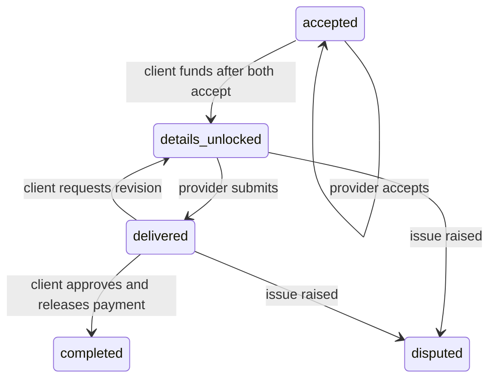

# Backend handoff

## Implemented API boundary

`src/api/marketplace.ts` owns the mock store and all UI mutations. UI components never import seed data. Its operations are:

| Operation      | Suggested endpoint                                          | Server expectations                                              |
| -------------- | ----------------------------------------------------------- | ---------------------------------------------------------------- |
| getSnapshot    | Split into GET /gigs, /orders, /providers, /threads, /flags | Return only role-authorised resources; cursor/page pagination    |
| createGig      | POST /gigs                                                  | Validate brief, budget, deadline, public contact masking         |
| propose        | POST /gigs/:id/proposals                                    | Provider session, price and message validation, duplicate policy |
| acceptProposal | POST /proposals/:id/accept                                  | Client owns the gig, agreement created once                      |
| actOnOrder     | POST /orders/:id/actions                                    | Participant role, expected order version, idempotency key        |
| sendMessage    | POST /threads/:id/messages                                  | Membership, server masking, rate limit and rolling strike window |
| reviewCase     | POST /flags/:id/review                                      | Admin role, reason, audit trail                                  |

Use httpOnly sessions. The demo role selector is not production authentication. Resource filtering and role checks on read responses are mandatory. Do not expose the complete mock snapshot in production.

## Order rules

Funding and private-detail access are a single atomic mock effect. Production must retain escrow_funded as its own auditable event, reconcile payment-provider callbacks and only reveal details after a confirmed payment plus both acceptances. The UI never directly calls a details-reveal endpoint. Private details must be absent from unfunded responses, not merely hidden with CSS. Terminal dispute resolution, appeals, refunds and split payouts remain to be implemented.

Money is integer BDT taka. The service supplies feeRate; fee is rounded once to the nearest taka and net = gross − fee. Production must provide authoritative fee lines and payment-provider rounding. Idempotency keys belong in persistent server storage, scoped to actor and operation, with an atomic operation/result record. The demo Set is not sufficient for production.

## Privacy

Public Provider has no phone, email, NID, payment or exact-address fields. The mock masks Bangladesh phone numbers (Latin/Bangla digits, basic separators), email, common URLs and handles before storing messages. Third detected contact-sharing attempt is blocked. The demo counter is global to the current tab, not the required per-user rolling 24-hour server counter. Spelled-out and adversarial obfuscation detection is not implemented. Do not rely on browser regular expressions for platform enforcement.

## Not connected

Live AI, KYC/selfie/NID upload, upload sanitisation/storage, real authentication, payments and payouts, notifications, CMS, persistence, moderation sanctions, full dispute decisions, file delivery and watermarking require backend implementation. Demo screens explicitly avoid collecting identity documents or payment credentials.

## Backend annotation index

- BACKEND: marketplace.ts transport replacement, permission and financial enforcement.
- WHY: Logo.tsx retains original supplied wordmark colours on its original light surface.
